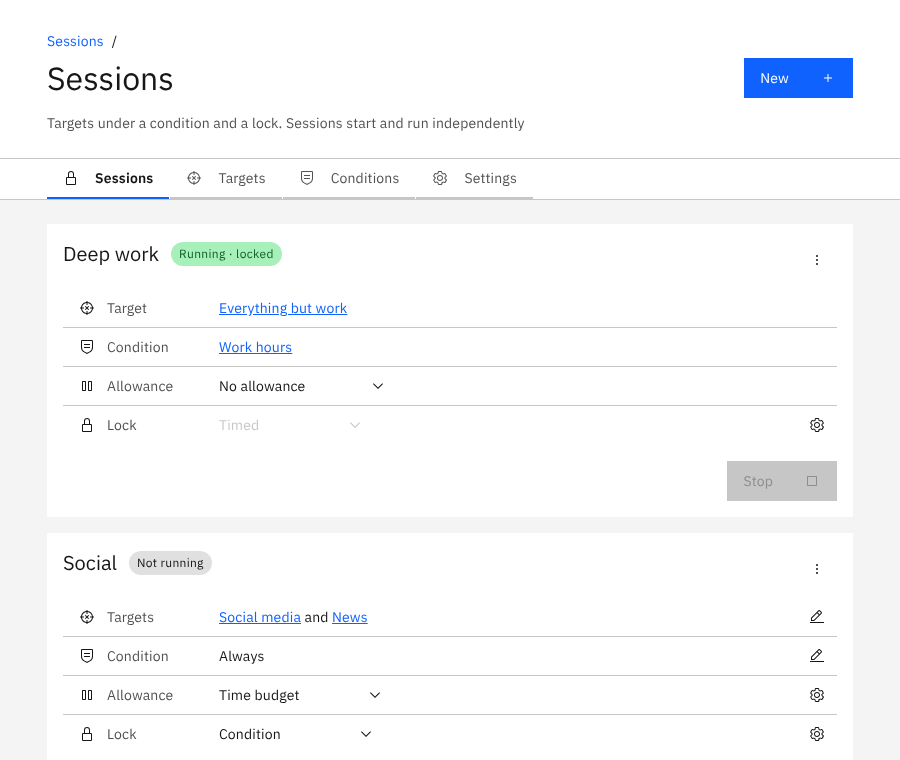
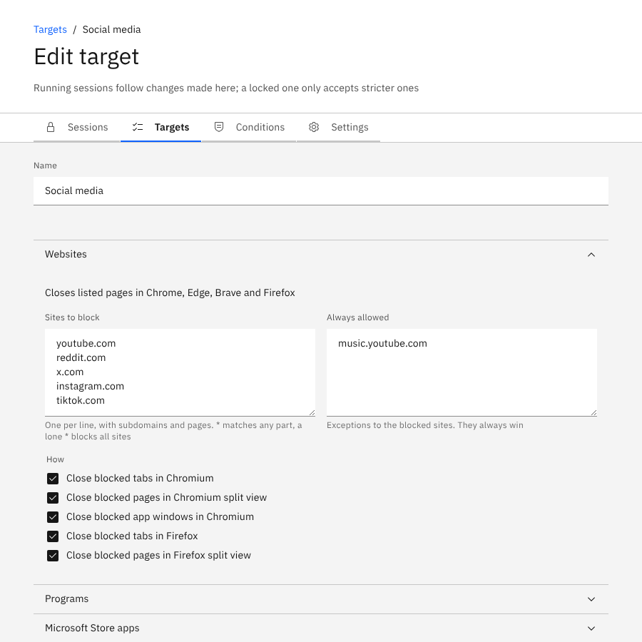
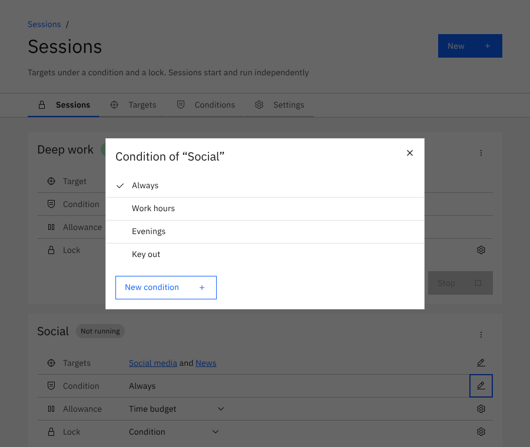
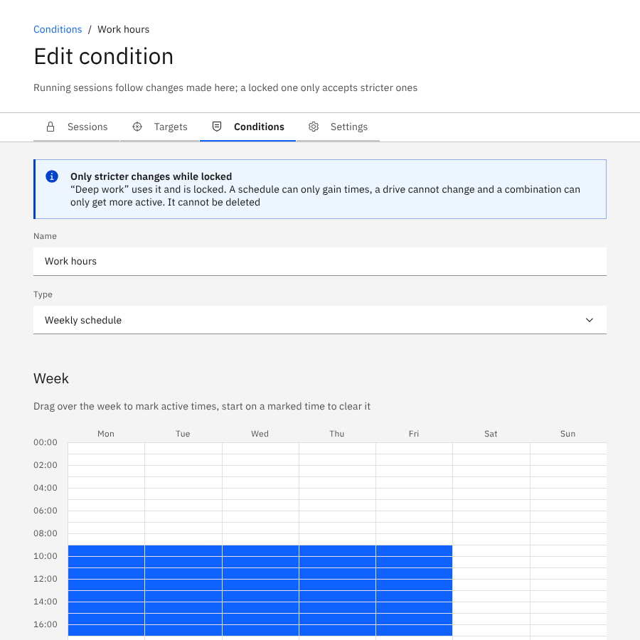

# Bullseye

A distraction blocker for Windows that you can hold yourself to. Bullseye closes the sites, programs, apps and windows you choose, when you choose, and it can lock itself so that stopping takes more than one click.



## How it works

You set up three kinds of things, each on its own tab:

| | What it is | Example |
|---|---|---|
| **Target** | *What* to block: sites, programs, Store apps and window titles, with exceptions | *Social media*: youtube.com, reddit.com, x.com, but music.youtube.com is fine |
| **Condition** | *When* a session is active | *Work hours*: Mon–Fri 08:30–17:30 |
| **Session** | What you start: targets, a condition, an allowance and a lock | *Deep work*: block everything but work sites during work hours, locked for 2 hours |

Two more ideas complete the picture:

- **Lock**: how hard a running session is to stop. None, for a while, until a date and time, until Windows restarts, while a condition is active (a USB stick can be the key: locked while it is unplugged), after a delay you have to wait out, after typing a text you cannot paste, or with a password someone else keeps.
- **Allowance**: a way for a session to go quiet for a while. A time budget (say 30 minutes a day, for the whole session or per site), a Pomodoro cycle (50 minutes blocked, 10 minutes free) or a delayed start (nothing is enforced for the first hour, or until a date and time, and everything is from then on).

Each target also has **actions**: the ways things are closed. Blocked tabs in Chrome, Edge, Brave and Firefox (split view and app windows too), programs by name, Store apps, windows by title (closed or minimized), and Obsidian's web viewer.



## Features

- **Sessions set up on their tiles**: each row (targets, condition, allowance, lock) is changed in place, from a list or a dropdown in the row. Several run at once, each started and stopped on its own, from the window or the command line, and a running session can be locked on the spot.
- **Conditions** by weekly schedule (drawn on a week grid), USB flash drive, webhook (any URL that answers, so you can hook up a home automation or a calendar), or any / all of those combined.
- **Locks that hold**: the rules live in a Windows service that runs as SYSTEM, so ending the app in Task Manager does not help, times are measured on internet time so changing the clock does not either, and sessions survive a restart. A locked session's targets and conditions can only be made stricter, and so can its lock (a later end, a longer wait) and its allowance.
- **A way out you choose**: Unlock in Settings ends every session, behind a countdown you set (none by default) and optionally another way, such as a password or the USB key.
- **Nothing hidden**: the service and app go by their own names and log what they do. It is friction, not spyware.
- **Export and import** everything to move to another computer.
- **A command line** that can do everything the window does: `bullseye status`, `bullseye start "Deep work"`, `bullseye target add "Social media" --sites tiktok.com`. See [CLI.md](CLI.md).

| | |
|---|---|
|  |  |

## Install

Download the installer from the [Releases](../../releases) page and run it (it needs administrator rights, as it installs a service). Bullseye starts in the tray: click its icon to open the window. Uninstalling is refused while a session is locked.

**Try a short lock first.** A locked session is meant to be hard to end. Keep the unlock delay short (or zero) until you know how you want to use it.

## Build it yourself

Prerequisites, on Windows 10 or 11:

- [Rust](https://rustup.rs) (stable, MSVC toolchain) with the Visual Studio C++ build tools
- [Node.js](https://nodejs.org) 22 or later
- WebView2 (included in Windows 11 and current Windows 10)

```powershell
git clone https://github.com/maakbaas/bullseye
cd bullseye
npm ci
npm run dev      # run the app without installing; its rules run inside it, no service needed
npm run build    # the installer, in src-tauri\target\release\bundle\nsis\
```

`cargo test` in `src-tauri` runs the tests. Every push to GitHub also builds the installer as a downloadable artifact (Actions tab).

## Make it your own

Everyone gets distracted differently, so Bullseye is meant to be forked and bent to fit. You do not need to know Rust or Windows internals to do that with an AI coding assistant:

1. **Fork the repository** and open it in an AI coding tool such as Claude Code. [AGENTS.md](AGENTS.md) (read by Claude Code through `CLAUDE.md`) explains the architecture, the rules and how each kind of extension is added, so the assistant starts with the context it needs.
2. **Ask for what you want in plain words**: "add a condition that is active while Spotify plays", "add a lock that needs a friend's approval by email", "close Discord when it shows a voice channel". New conditions, locks, allowances, actions and lists each follow a recipe in AGENTS.md (one table entry in the window, one type in Rust, one CLI option).
3. **Let it test**: the project expects every change to come with tests, and they run on Linux and Windows. Ask the assistant to run them and to check the window in a browser before you install.
4. **Develop with `npm run dev`**, which you can end at any time, and install only what you have tried there.

Changes that would be useful to others are welcome back as pull requests.

## More

- [CLI.md](CLI.md): the command line.
- [AGENTS.md](AGENTS.md): how it is built, for developers and AI assistants.
